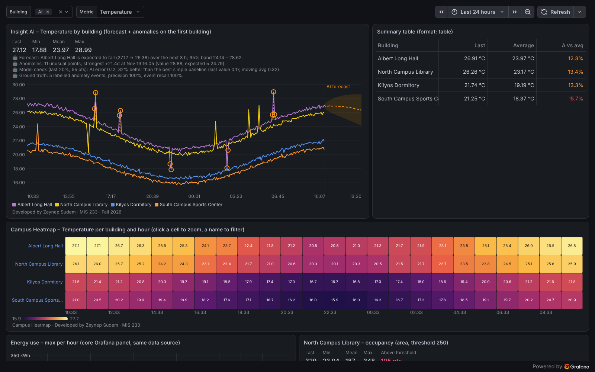
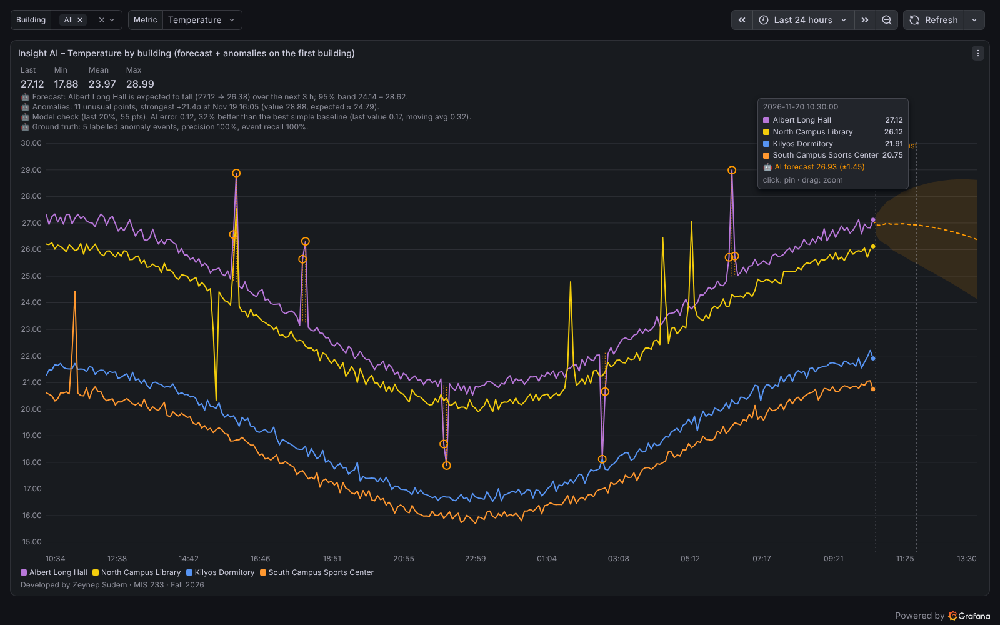
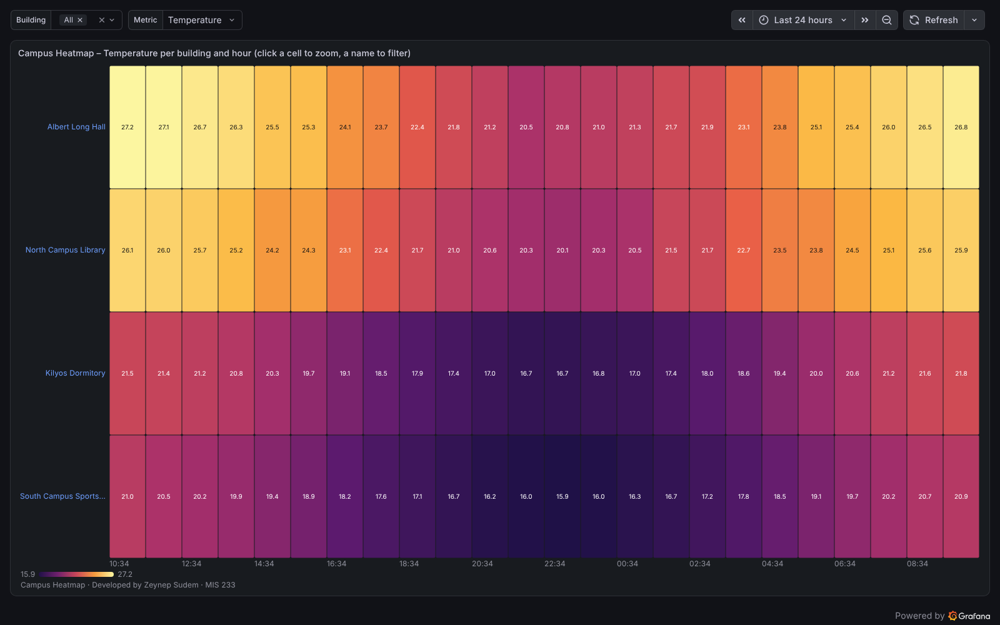
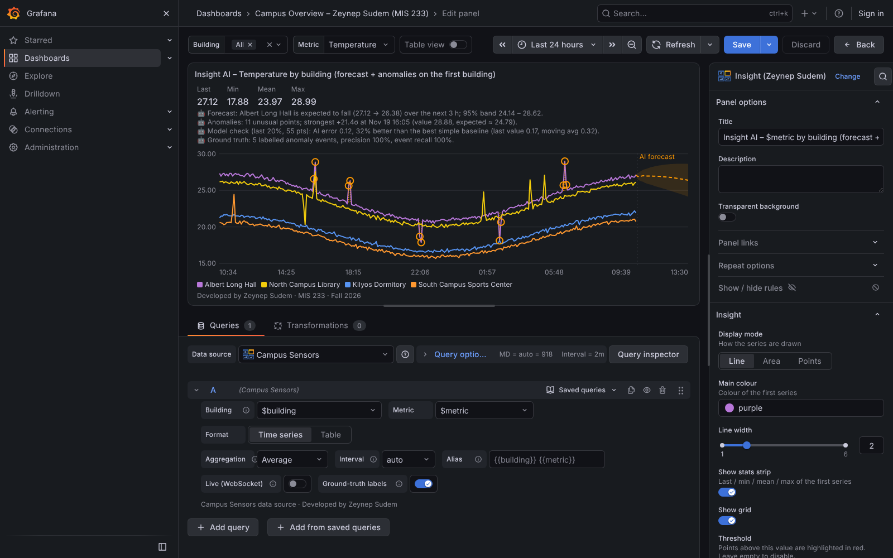
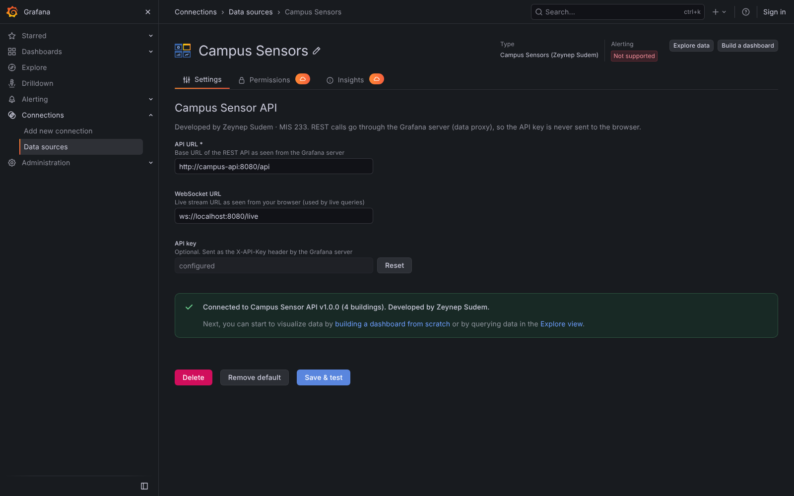
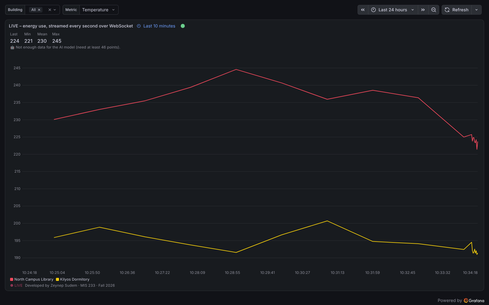
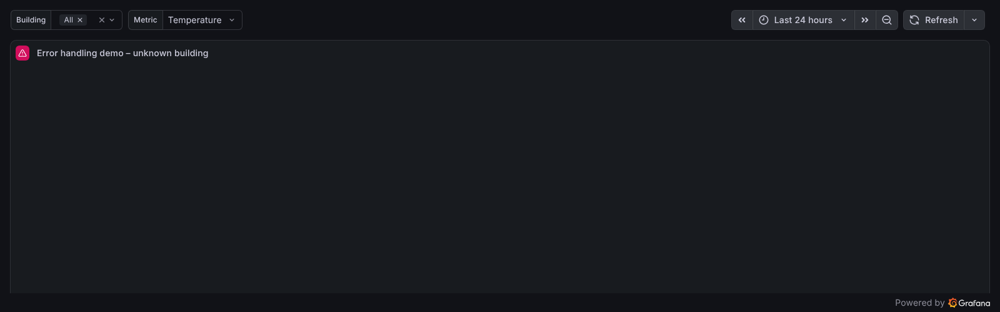

# Campus Insight – Grafana plugins with in-browser AI

**MIS 233 Advanced Web Development · Boğaziçi University · Fall 2026 · Final project**
**Developed by Zeynep Sudem** (individual project)

Three Grafana plugins and a small mock API that work together:

| Folder | Plugin type | What it does |
|---|---|---|
| [`zeynepsudem-insight-panel`](zeynepsudem-insight-panel) | Panel (required plugin) | Interactive time series panel with **Insight AI**: a neural network trained in the browser on the panel's data forecasts the next points and flags anomalies, then explains them in plain language |
| [`zeynepsudem-heatmap-panel`](zeynepsudem-heatmap-panel) | Panel (additional panel) | Building × time heatmap, click a cell to zoom, click a building to filter the dashboard |
| [`zeynepsudem-campus-datasource`](zeynepsudem-campus-datasource) | Data source | Reads campus sensor data from a REST API (time series or table), streams live data over WebSocket, readable error handling |
| [`mock-api`](mock-api) | Node.js service | "Campus Sensor API": deterministic synthetic sensor data for 4 campus buildings with injected anomalies, REST + WebSocket |

"Developed by Zeynep Sudem" is shown at the bottom of every panel, in the data source settings and in the query editor.



---

## Quick start

Requirements: **Docker Desktop**, **Node.js 24+** (`node -v`), Git. Tested on macOS (Apple Silicon) and Linux.

```bash
git clone <this repository> mis233-grafana
cd mis233-grafana
npm run setup      # installs the packages of the three plugins (first time only, ~2 min)
npm run build      # builds the three plugins into their dist/ folders
npm start          # = docker compose up -d --build  (Grafana + Campus Sensor API)
```

Open **http://localhost:3000**. The home page is the *Campus Overview* dashboard (anonymous admin access is enabled for the demo; the normal login `admin` / `admin` also works).

Stop everything with `npm run stop` (= `docker compose down`).

> If you use Anaconda, run `conda deactivate` first: Anaconda ships an older Node.js that the Grafana build tools do not accept.

### What is started

| Container | Port | Purpose |
|---|---|---|
| `mis233-grafana` | 3000 | Grafana Enterprise 13.2.4 with the three unsigned plugins allowed and everything provisioned |
| `mis233-campus-api` | 8080 | Campus Sensor API (REST under `/api`, WebSocket on `/live`) |

Provisioning ([`provisioning/`](provisioning)) creates the **Campus Sensors** data source (API URL, WebSocket URL and a secret API key) and two dashboards: *Campus Overview* and *Zeynep Sudem – Insight demo* (TestData).

### Developing

```bash
cd zeynepsudem-insight-panel   # or any plugin folder
npm run dev                    # rebuilds on every save; refresh the browser to see changes
```

Changes to a `plugin.json` need a Grafana restart: `docker restart mis233-grafana`.

---

## Features

### 1. Insight panel (`zeynepsudem-insight-panel`)

- Renders **real query data** from any data source (every numeric field with a time field becomes a series)
- **Options**: display mode (line / area / points), main colour, line width, grid, stats strip (last / min / mean / max), **threshold** (points above it are red and counted)
- **Interactivity**: hover tooltip with all series, **click** to pin a point (shows difference from the mean, and the AI verdict if it is an anomaly), **drag** to zoom the dashboard time range, **click the legend** to hide / show a series
- **Responsive**: compact layout under 320 × 170 px (no axes, no stats), tick density follows the panel size, tooltip flips side near the right edge, works at phone width
- **Live data**: when the query is streaming the window slides with the newest point and a pulsing ● LIVE badge is shown
- **Insight AI** (see [AI section](#ai-insight-ai-forecasting-and-anomaly-detection-in-the-browser))
- Readable **error state**: if the query fails the panel shows the data source's error message



### 2. Campus Heatmap panel (`zeynepsudem-heatmap-panel`) – additional panel

- One row per series (building), one column per time bucket, colour = average value, with colour legend
- **Click a cell** → dashboard zooms to that time bucket; **click a building name** → sets the `building` dashboard variable (drill-down)
- Options: colour scheme (heat / cool / diverging), number of columns (auto fits the width), values in cells, drill-down variable name
- Text colour inside a cell is chosen for contrast (black / white)



### 3. Campus Sensors data source (`zeynepsudem-campus-datasource`)

- **REST API** through Grafana's data proxy (`routes` in `plugin.json`): the browser never sees the API key, which is stored in `secureJsonData` and added as the `X-API-Key` header by the Grafana server
- **Query editor parameters**: building (one, all, or a dashboard variable), metric, **format** (time series / table), aggregation (avg / min / max / last), interval (auto, 1m … 6h), alias (`{{building}}`, `{{metric}}`), **live** switch, ground-truth labels switch
- **Data frames**: one time series frame per building with the right unit (°C, %, kWh) and a `building` label; or one **table** frame with last / min / max / average / change vs average
- **Dashboard variables**: variable query `buildings` or `metrics`
- **Error handling**: every query runs separately (one failing query does not hide the others) and errors become sentences, e.g. *"Campus API is unreachable (http://campus-api:8080/api). Is the campus-api container running?"*, *"Unknown building …"*, *"rejected the request (HTTP 401). Check the API key"*. *Save & test* checks both reachability and the API key.
- **Live mode (WebSocket)**: loads the history over REST, then opens `ws://localhost:8080/live`, subscribes to the metric / buildings and appends one point per second (`LoadingState.Streaming`), trims the sliding window, reconnects with exponential back-off and closes the socket when the panel goes away

| Query editor | Settings + Save & test |
|---|---|
|  |  |





### 4. Campus Sensor API (`mock-api`)

| Endpoint | Description |
|---|---|
| `GET /api/health` | status, version, developer |
| `GET /api/buildings`, `GET /api/metrics` | lists for the query editor and variables |
| `GET /api/series?metric=&building=&from=&to=&interval=&agg=&truth=1` | time series per building; `truth=1` adds the ground-truth anomaly label to each point |
| `GET /api/summary?metric=&building=&from=&to=` | one row per building (last, min, max, avg, change %) |
| `ws://…/live` | send `{"type":"subscribe","metric":"energy","building":"all","intervalMs":1000}`, receive `{"type":"points",…}` every interval |
| `?simulate=503` / `?simulate=timeout` | simulate failures for error-handling demos |

Data is **deterministic** (hash based): the same building, metric and time always give the same value. It has a daily rhythm (peak around 14:00 Istanbul time), a weekend effect, smooth noise, a slow drift, and **rare injected anomalies** (spikes / drops lasting a few minutes) whose positions are known – this is the ground truth used to evaluate the AI. Invalid input returns clear 400 / 404 JSON errors; with `API_KEY` set, requests need the `X-API-Key` header.

---

## AI: "Insight AI" – forecasting and anomaly detection in the browser

**Idea.** A Grafana panel already receives the data; instead of sending it to an external AI service, the panel **trains its own small neural network in the browser** on exactly the series it is showing, every time the data changes. Nothing leaves the user's machine, there is no API key, and it works offline. The model answers three questions a person looking at a sensor chart has: *What happens next? Is anything unusual? Can I trust the model?* – and answers them in plain language above the chart.

**Method** (all code in [`zeynepsudem-insight-panel/src/ai`](zeynepsudem-insight-panel/src/ai), no ML library):

1. **Model** – a multi-layer perceptron (12 inputs + time of day → 16 tanh units → 1) written from scratch in TypeScript and trained with mini-batch **Adam** and L2 weight decay; seeded random numbers make results reproducible.
2. **Features** – the last 12 values *relative to the most recent value*, the most recent value, and the time of day as sin / cos. The network predicts the **change** to the next value, so "no change" (the naive baseline) is the easy starting point and the network only has to learn what improves on it. This single design choice raised the average improvement over the baselines from −10 % to +33 %.
3. **Anomalies** – one-step-ahead prediction errors are scored with a **robust z-score** (median and MAD instead of mean and standard deviation, so the anomalies themselves do not inflate the scale). Points above the threshold (default 3.5σ, adjustable) are flagged. While walking along the series, a flagged value is replaced by the model's own prediction (**online cleaning**), so one spike does not corrupt the inputs of the next 12 predictions.
4. **Robust re-training** – the model is trained a second time on the cleaned series and detection is repeated.
5. **Honest evaluation** – a separate model is trained on the first 80 % only; its error on the last 20 % is compared with two baselines (*last value* and *moving average*). The panel prints the result, including when the AI is *worse*.
6. **Forecast** – recursive multi-step prediction with a 95 % band that widens with √h.
7. **Ground truth** – when the data source sends the API's injected-anomaly labels, the panel reports **precision** and **event recall** live.

Training runs outside the render pass, uses at most the last 1 500 points, and takes about 50–150 ms; while streaming it retrains at most every 15 s.

**Results.** [`insight.research.test.ts`](zeynepsudem-insight-panel/src/ai/insight.research.test.ts) runs the method on all 16 building × metric series at three resolutions (48 series) against the API's ground truth. It is part of `npm test`, so anyone can reproduce it:

| Setup | AI error vs best baseline | Anomaly precision | Anomaly event recall | Time |
|---|---|---|---|---|
| 6 h @ 1 min | 19 % lower | 0.50 (avg per series) | 1.00 | ~165 ms |
| 24 h @ 5 min | 27 % lower | 0.91 | 1.00 | ~125 ms |
| 72 h @ 15 min | 53 % lower | 0.95 | 0.91 | ~125 ms |

Sensitivity sweep on the noisiest data (6 h @ 1 min, 16 series, pooled):

| Threshold | Points flagged | Precision | Event recall |
|---|---|---|---|
| 2.5σ | 228 | 0.25 | 1.00 |
| **3.5σ (default)** | 72 | 0.78 | 1.00 |
| 4.5σ | 56 | 1.00 | 1.00 |
| 5.5σ | 56 | 1.00 | 1.00 |

**Findings.** (1) Predicting the *change* instead of the level is what makes a tiny network beat simple baselines. (2) More history helps a lot (+53 % at 72 h vs +19 % at 6 h) because the network sees several daily cycles. (3) At 1-minute resolution sensor noise causes false alarms at 3.5σ; 4.5σ removes them without losing any real event, so the threshold is exposed as a panel option. (4) Limitation: the data is synthetic, so real sensors (missing data, sensor drift, holidays) would need more validation.

---

## Tests

```bash
npm test          # all unit tests (3 plugins + API)
npm run e2e       # browser smoke test against the running stack (needs: npm install && npx playwright install chromium)
```

| Part | Tests | What is covered |
|---|---|---|
| Insight panel (Jest) | 24 | data frame conversion, axis ticks, number formatting, MLP training, anomaly detection on synthetic spikes, forecast band, ground-truth scoring, summary text, panel rendering (credit, stats, threshold, compact mode, error state, LIVE badge), research check |
| Heatmap panel (Jest) | 4 | bucketing, empty data, colour scale, text contrast |
| Data source (Jest) | 17 | frames, alias, table, truth field, error messages, proxy URL and parameters, table endpoint, partial failures, Save & test, variables, live stream (history → streaming → reconnect, window trimming) with a fake WebSocket |
| Campus API (`node:test`) | 7 | endpoints, validation errors, determinism, truth labels, injected anomalies, WebSocket subscribe / stream / error |
| End-to-end (Playwright) | 8 checks | name visible, data drawn, table, AI summary, heatmap, error message, live stream, Save & test |

All plugins pass `tsc --noEmit` and ESLint (Grafana config) with no warnings.

---

## Bonus points claimed

| Category (from the assignment) | Claimed | Where |
|---|---|---|
| **Required**: plugin builds, loads, shows my name | ✅ | every panel footer, data source settings, query editor |
| **Panel ops** | real query data, 6 options, hover / click-to-pin / drag-to-zoom / legend toggle, responsive compact mode, threshold highlighting, live sliding window | Insight panel |
| **Additional panel** (+1) | Campus Heatmap panel with click-to-zoom and click-to-filter | `zeynepsudem-heatmap-panel` |
| **Datasource add** (+5) | new data source plugin | `zeynepsudem-campus-datasource` |
| **Datasource ops** (1/3/5) | REST API, 8 query parameters, time series **and** table frames, aggregation, dashboard variables, alias, secure API key via data proxy, per-query error handling, Save & test | data source |
| **Datasource usage** (+1) | also uses Grafana's existing TestData data source (*Insight demo* dashboard) and core Grafana panels with my data source | dashboards |
| **WebSocket** (+5) | live streaming over WebSocket with reconnect | `mock-api/live.js`, `src/live.ts` |
| **AI** (1–10) | in-browser neural network: forecast with uncertainty, robust anomaly detection, honest baseline comparison, ground-truth evaluation over 48 series, plain-language explanation | `zeynepsudem-insight-panel/src/ai` |
| **Test** (+1) | 52 unit tests + end-to-end smoke test | see *Tests* |
| **Good code** (1–3) | TypeScript, pure functions separated from React components, no `any` in production code, lint clean, comments explain *why* | whole repo |
| **Documentation** (+1) | this README, plugin READMEs, screenshots | |
| **GitHub** (+1) | public repository: https://github.com/zypaktas/mis233-grafana | |
| **YouTube** (+1) | demo video: https://youtu.be/cpR3nQ-d0oQ | |
| **VBB** | original AI idea (private, offline, self-evaluating), research method with ground truth and a sensitivity study | AI section |

---

## Project structure

```
mis233-grafana/
├── docker-compose.yaml          # Grafana + Campus Sensor API
├── package.json                 # setup / build / test / start / stop for everything
├── provisioning/                # data source + dashboards (dashboard JSON lives here)
│   ├── datasources/datasources.yml
│   └── dashboards/campus-overview.json, insight-testdata.json
├── zeynepsudem-insight-panel/   # panel + AI   (src/components, src/ai, src/utils)
├── zeynepsudem-heatmap-panel/   # second panel (src/components, src/heatmap.ts)
├── zeynepsudem-campus-datasource/  # data source (datasource.ts, live.ts, convert.ts, components/)
├── mock-api/                    # server.js (REST), live.js (WebSocket), data.js (generator), test/
├── e2e/smoke.mjs                # browser smoke test
└── docs/screenshots/
```

Each plugin was created with `npx @grafana/create-plugin@9.0.4` (Grafana 13.2, React 19, webpack + SWC); the generated `.config` folders are unchanged.

## License

Apache-2.0 (as generated by the Grafana plugin template).
